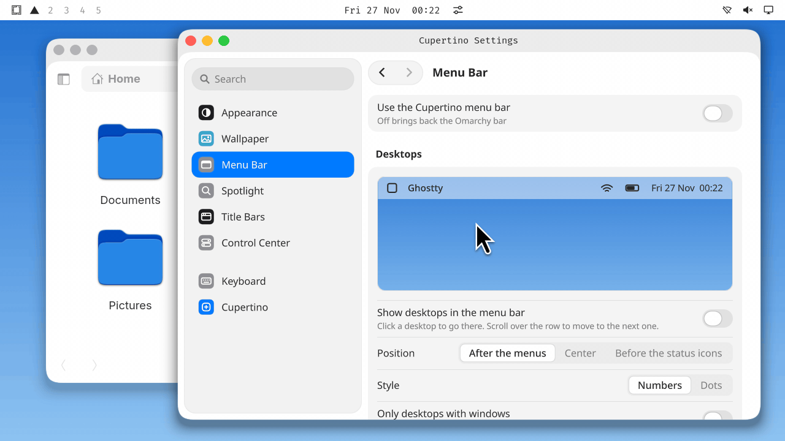
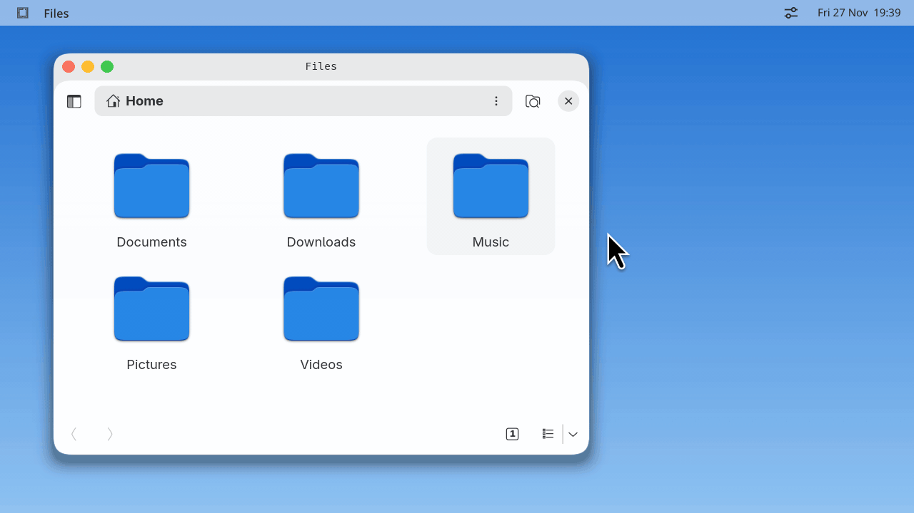
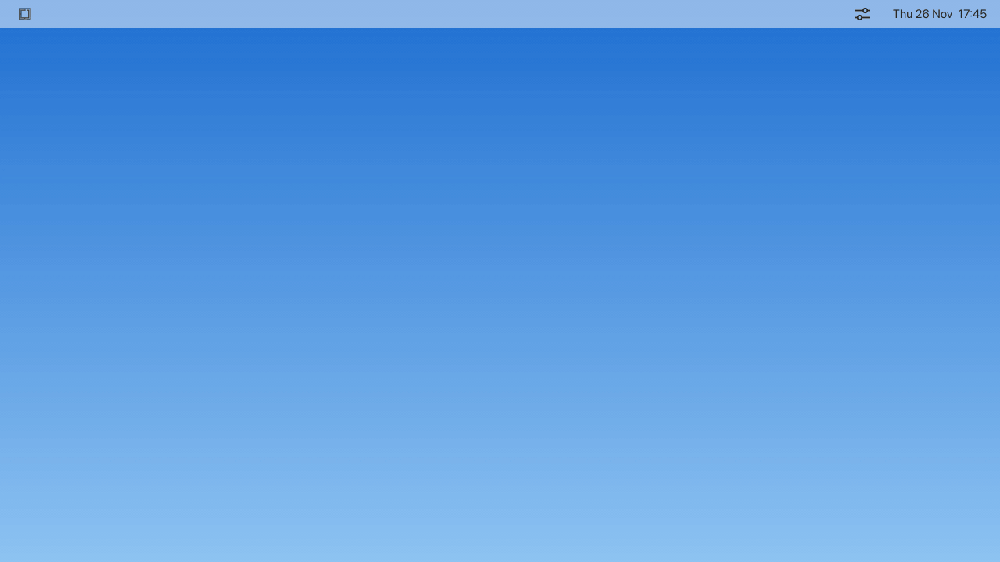
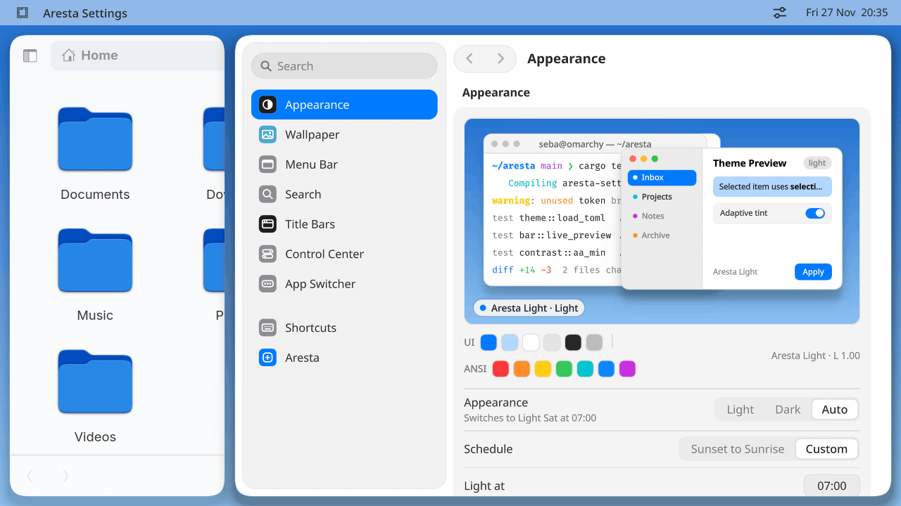

# omarchy-cupertino

A macOS look for [Omarchy](https://omarchy.org) 4.5 or newer.

| Part | What you get |
| --- | --- |
| [Menu bar](#menu-bar) | A Mac-style top bar in place of the Omarchy bar |
| [Control Center](#control-center) | One panel for Wi-Fi, Bluetooth, Focus, display, sound and media |
| [Spotlight](#spotlight) | The Omarchy menu drawn as macOS Spotlight |
| [Title bars](#title-bars-and-windows) | Traffic lights on floating workspaces, rounded corners everywhere |
| [Themes](#themes) | OSX Light and OSX Dark |
| [Shortcuts](#keyboard-shortcuts) | Super+Tab, Super+Q and other macOS keys on Super |
| [Cupertino Settings](#cupertino-settings) | One app that turns each part on or off |

Each part has a switch. Turning one off gives back Omarchy's own behavior.
See [Install](#install) to get started.

## Menu bar



The menu bar replaces the Omarchy bar. It is sized and spaced like the macOS
menu bar.

- **Left:** the Omarchy menu button and the focused app's name.
- **Right:** your status widgets, third-party ones too, and the date and time.
- **Look:** text and icons in your theme's bar text color, dark on light themes
  and light on dark themes, on a translucent, unblurred background. It uses SF
  Pro when it is installed, else Inter or Noto Sans.

## Control Center



The Control Center sits next to the clock. One panel:

- turns Wi-Fi, Bluetooth and Focus on or off;
- picks the sound output;
- sets the display brightness and the volume;
- controls the media that plays.

While it is on, the bar hides Omarchy's network, Bluetooth, sound, system
monitor and battery icons, unless you keep one in the bar.

## Spotlight



Super+Space, the bar's menu button and `omarchy-menu` open one search field
with a blinking cursor. Results show apps first, then menu rows with their
path.

- **Math:** an expression such as `2^10` or `sqrt(2)*pi` shows its result in
  the field and on a card above the results. Enter or the copy button copies
  it.
- **Submenus:** a submenu shows as a chip in the field. Backspace on an empty
  field goes back.
- **Sections:** Ctrl+1 to Ctrl+9 open Apps, as an icon grid, or a menu
  section, because Super+1 to Super+9 switch workspaces. An optional row of
  filter buttons under the field does the same. Each button shows its name
  and shortcut on hover.
- **Size and place:** the card grows with the results up to the screen edge,
  then scrolls. Drag the card by its field or its sides to move it, or by its
  top or bottom edge to change its height. It opens that way next time on
  that display.
- **Scripts:** scripts that use the menu as a picker, such as
  `omarchy-menu-keybindings`, keep working.

## Title bars and windows



- **Windows on floating workspaces** get a title bar with traffic lights:
  close, minimize and maximize on the left, grey when the window is
  unfocused, icons on hover, and the title centered.
- **Tiled windows** get no title bar.
- **Every window** gets rounded corners, a soft shadow and a thin neutral
  outline instead of a colored border.

Turn a workspace floating with Omarchy's workspace layout toggle to see the
title bars.

## Themes

Two Omarchy themes in macOS system colors: OSX Light and OSX Dark. Each has
the Yaru blue icons and an original gradient background. Pick them in the
Omarchy theme menu or with `omarchy-theme-set "osx light"`.

## Keyboard shortcuts

| Shortcut | Action |
| --- | --- |
| Super+Tab | App switcher, like Cmd+Tab |
| Super+Q | Quit the app: close every window of its class, on all workspaces |
| Super+W | Close only the window (unchanged) |
| Super+M | Minimize the window to the dock (Omarchy's binding, unchanged) |
| `` Super+` `` | Cycle between windows of the same app, skipping minimized ones |
| `` Super+Alt+` `` | Quake console, moved from `` Super+` `` |

The app switcher shows one icon per app in most-recently-used order, in a
rounded strip in the middle of the screen. Hold Super, press Tab or Shift+Tab
or point at an icon to move, and release Super to switch. Click an icon to
switch at once, or press Esc to cancel. Switching to a minimized app brings
its window back.

The switcher replaces Omarchy's next and previous workspace bindings on
Super+Tab and Super+Shift+Tab. It is its own shell plugin, so it keeps
working when you switch back to the Omarchy bar.

## Cupertino Settings

Cupertino Settings is a small app in the style of macOS System Settings.
Open it from the app launcher.

| Section | What you set |
| --- | --- |
| Appearance | Light, Dark or Auto; the light and the dark theme from the installed Omarchy themes, in lists that follow the themes you add or remove while the window is open; window shadows; translucent panel backgrounds and opacity for Control Center, Spotlight and the app switcher. It also shows the colors of the current theme. Auto picks the light theme at sunrise and the dark theme at sunset, or at the two times you set under Schedule, Custom. |
| Wallpaper | The current wallpaper and a switch that keeps it when the theme changes. It lists the pictures of the theme, of `~/.config/omarchy/backgrounds/<theme>` and of folders you add. Add Photo copies a picture into `~/.config/omarchy/backgrounds/<theme>`. |
| Menu Bar | The menu bar itself; desktops in the bar (after the menus, in the center or before the status icons, as numbers or dots); the bar background opacity; the clock format. |
| Spotlight | Spotlight itself (off gives back the Omarchy menu); size from 80% to 150%; a gray or theme accent selected row; the filter buttons; open with only the search field until you type; keyboard hints at the bottom of the card; lock the card's place and size; put it back at its default place and height. |
| Title Bars | The title bars themselves, with a preview of two windows on your wallpaper; title bars on tiled windows too; button position (left or right); grey traffic lights on unfocused windows; icons in the traffic lights on hover; title alignment; traffic light size. Off gives back Omarchy's own title bars. |
| Control Center | The Control Center itself (off gives back Omarchy's bar icons); the controls the panel shows; the Omarchy icons that also stay in the menu bar. |
| Keyboard | Quit app, Cycle windows, the app switcher and the Quake console keys on or off, and new shortcuts for them. Omarchy's own bindings show as read-only. |
| Cupertino | Options that macOS does not have: rounded corners and their radius and shape, the thin border, the shadow and the bar size. |

Turning a part off gives back Omarchy's own behavior: the Omarchy bar, its
status icons, title bars, square corners, colored border, menu, or its
Super+Q, `` Super+` ``, `` Super+Shift+` ``, Super+Tab and Super+Shift+Tab
bindings.

Changes apply at once. The app saves them to
`~/.config/omarchy-cupertino/settings.toml`, which the Hyprland config and the
bar read. Without that file, every option keeps its default.

The app is written in Rust with [cxx-qt](https://github.com/KDAB/cxx-qt) and
QML. To build it by hand you need Rust (`cargo`) and Qt 6:

```sh
cargo build --release --manifest-path app/Cargo.toml
```

## Install

```sh
./install.sh
```

It links `hypr/omarchy-cupertino.lua` into `~/.config/hypr`, adds
`require("hypr.omarchy-cupertino")` to `~/.config/hypr/hyprland.lua` before
`require("default.hypr.toggles")`, and reloads Hyprland. Before it edits
`hyprland.lua`, it copies the file to `$CUPERTINO_BACKUP_DIR/hyprland.lua.orig`
(default `/tmp/omarchy-cupertino`). It also links the repository into
`~/.config/omarchy/plugins` and selects the Cupertino bar, after it copies
`~/.config/omarchy/shell.json` to `$CUPERTINO_BACKUP_DIR/shell.json.orig`.
It links `switcher/` into `~/.config/omarchy/plugins` and enables it. It
links `menu/` into `~/.config/omarchy/plugins` and enables it, which turns off
the Omarchy menu. It links `control-center/` into
`~/.config/omarchy/plugins` and enables it.
It links `themes/osx-light` and `themes/osx-dark` into
`~/.config/omarchy/themes`, and links a `theme-set` hook into
`~/.config/omarchy/hooks/theme-set.d` that keeps the current wallpaper on a
theme switch unless you turn that off. Finally, it builds Cupertino Settings
with `cargo` and installs it to `~/.local/bin/cupertino-settings`, with a
launcher entry in `~/.local/share/applications`.
It also installs the `cupertino-auto` systemd user timer, which runs
`cupertino-settings --auto` every minute for Auto appearance. Auto reads your
location from `~/.local/state/omarchy/settings/weather.json`, else from
`https://geo.omarchy.org/`, and computes sunrise and sunset on your computer.
With a Custom schedule, Auto uses your local time and needs no location.
Running the script again changes nothing.

## Uninstall

```sh
./uninstall.sh
```

It restores `shell.json` from the backup (or selects the default bar when
the file changed since), disables the Spotlight menu so the Omarchy menu
comes back, disables the Control Center, removes the plugin links, the theme links, the hook
link, the `require` line, the Hyprland link, the Cupertino Settings binary
and launcher entry and the `cupertino-auto` timer, then reloads Hyprland. It
keeps your settings file.

## Credits

The title bar code is based on the
[macOS Dock plugin](https://github.com/rafabertholdo/omarchy-macos) by Rafael Bertholdo
(MIT). The app switcher is based on Renan Tonheiro's Switch Magic plugin
(MIT). See `LICENSE`.
